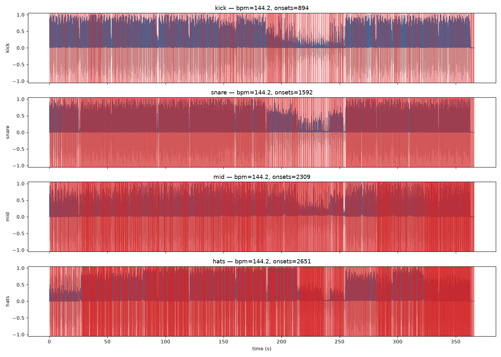
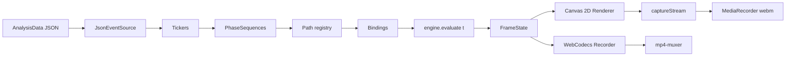

# scenic-motion-engine-web

> Audio-reactive looping marquee. A pure `evaluate(t) -> FrameState` engine drives per-row scrolling, GPU-free Canvas 2D text, deterministic jitter, and camera moves from four-band transient events in a pre-analyzed audio track.

[](https://github.com/danielesiegel/scenic-motion-engine-web)
[](https://www.typescriptlang.org/)
[](https://vitejs.dev/)
[](./LICENSE)
[](https://github.com/danielesiegel/scenic-motion-engine-web/commits)
[](https://github.com/danielesiegel/scenic-motion-engine-web/issues)


The frame is filled with horizontal rows of **`scenicsynth`** repeating with the shared trailing/leading `s` collapsed; one or more 12-glyph **`scenicsynths`** spans are rendered in a brighter "key" color. Alternate rows scroll opposite directions. All motion — row velocity, glyph jitter, camera zoom/tilt/pan — is driven by per-band transient events (kick / snare / mid / hats) from a pre-analyzed audio track.

The engine is a **pure function of time**: `evaluate(t, config, source) -> FrameState`. No mutable accumulators. Scrubbing, looping, and offline frame-by-frame export are frame-identical to live playback.

> **Status:** this is the TypeScript / Canvas 2D prototype. A Rust / Metal native Mac port is in progress at [`scenic-motion-engine-mac`](https://github.com/danielesiegel/scenic-motion-engine-mac). The web version is kept as a reference implementation; expect latency and dropped frames on dense tracks in-browser.

---

## Table of Contents

- [Features matrix](#features-matrix)
- [Demo](#demo)
- [Install](#install)
- [Analyze a track](#analyze-a-track)
- [Preview](#preview)
- [Record](#record)
- [Deterministic exporter](#deterministic-exporter)
- [Workflow](#workflow)
- [Architecture](#architecture)
- [Configuration reference](#configuration-reference)
- [Text pattern](#text-pattern)
- [Motion extension](#motion-extension)
- [Tests](#tests)
- [Troubleshooting](#troubleshooting)
- [Project layout](#project-layout)
- [Roadmap](#roadmap)
- [Related projects](#related-projects)
- [Contributing](#contributing)
- [License](#license)
- [Acknowledgements](#acknowledgements)

---

## Features matrix

| Feature                           | Web (TS) | Mac native (Rust) | Notes                                                              |
| --------------------------------- | :------: | :---------------: | ------------------------------------------------------------------ |
| Deterministic `evaluate(t)` engine | yes      | yes               | Same semantics; same analysis JSON format                          |
| GPU text                          | no       | yes               | Canvas 2D CPU rasterization vs. glyphon + wgpu/Metal atlas         |
| Native audio playback             | no       | yes               | Browser audio graph vs. `cpal` + `symphonia`                       |
| Four-band transient detection     | yes      | yes               | Python `scripts/analyze.py` (librosa) — shared                     |
| Feel presets                      | yes      | yes               | `default / snappy / smooth / punchy / glacial / bouncy / custom`   |
| Cubic-bezier easing               | yes      | yes               | Newton-Raphson solver + 19 named curves                            |
| U-curve row velocity              | yes      | yes               | `flat / u / inverted-u / linear` + edge multiplier                 |
| Random focused zoom               | yes      | yes               | `cameraZoomDeltaFocused` with deterministic hash                   |
| Spotlight repetition              | yes      | yes               | `travels` / `anchored` modes, per-row phase scatter                |
| Record to MP4                     | yes      | WIP               | WebCodecs + mp4-muxer in Chrome / Arc; MediaRecorder webm fallback |
| Record to webm fallback           | yes      | n/a               | `canvas.captureStream` + MediaRecorder                             |
| Deterministic server-side render  | yes      | WIP               | Playwright + ffmpeg pipeline in `scripts/render.ts`                |
| Scrub + loop                      | yes      | WIP               | Scrub bar + region loop below the stage                            |
| HUD overlay                       | yes      | WIP               | Per-ticker phase, since-last, strength readout                     |

---

## Demo

Short clips land here once the first builds are captured.

- `docs/screenshots/stage.png` — TODO: capture a frame of the live preview
- `docs/screenshots/panel.png` — TODO: capture the Tweakpane control panel
- `docs/clips/kafkaesque-60s.mp4` — TODO: 60s rendered sample

Diagnostic plot from the Python analyzer (actually in the repo):



The analyzer emits one PNG per track showing waveform, per-band onset envelopes, and the detected transient points. Review it before trusting the JSON — if events look missed or over-triggered, re-run with different `--k-kick / --k-snare / ...` sensitivities.

---

## Install

```bash
npm install
```

Drop a `.wav` into `assets/audio/` and a font (`ITC Avant Garde Gothic LT Demi` or a URW Gothic / TeX Gyre Adventor fallback) into `assets/fonts/`. See `src/text/font.ts` for the full candidate filename list.

Node 20+. Tested on macOS 14 / Chrome 120 / Arc 1.42.

---

## Analyze a track

Run once per track. Produces `analysis/<track>.json` (consumed by the engine) and a diagnostic PNG.

```bash
python3 -m venv .venv
source .venv/bin/activate
pip install -r scripts/requirements.txt
npm run analyze -- --input assets/audio/<track>.wav
```

Flags:

| Flag                                            | Purpose                                                           |
| ----------------------------------------------- | ----------------------------------------------------------------- |
| `--kick-lo / --kick-hi / --snare-lo / ...`      | Band-edge frequencies in Hz                                       |
| `--k-kick / --k-snare / --k-mid / --k-hats`     | Adaptive-threshold sensitivity (lower = more events)              |
| `--ref-kick / --ref-snare / --ref-mid / ...`    | Refractory window (ms) — minimum gap between events               |
| `--stems`                                       | Use `demucs` separation (if installed) before band filtering      |
| `--help`                                        | Full list                                                         |

Analysis JSON schema is a strict subset of `AnalysisData` in `src/types.ts` so the Rust port consumes the same files unchanged.

---

## Preview

```bash
npm run dev
```

Vite dev server at `http://127.0.0.1:5173/`.

Live GUI (Tweakpane) folders:

- **feel** — preset (`default | snappy | smooth | punchy | glacial | bouncy | custom`), horizontal × scale, duration scale, global easing override, cubic-bezier override, row velocity curve (`flat | u | inverted-u | linear`) with edge multiplier.
- **layout** — font size, leading, rotation, row stagger, margin, `renderScale (live)` supersampling.
- **colors / spotlight / text** — self-explanatory.
- **spotlight** — `rows` (`all / even / odd / single`), `frequency` (every Nth unit gets a spotlight), `offsetUnits`, `rowPhaseOffset` (scatter per row), `mode: travels / anchored`.
- **band thresholds** — kick / snare / mid / hats runtime strength filter.
- **tickers** — per-ticker modulo, band, strength, `step` + `stepOffset` (fire every Nth event with offset — e.g. 4th / 8th / 12th kick).
- **bindings** — per-phase path + duration + easing.
- **camera baseline** — static zoom / pan / tilt + `rowOvershoot` (extra overflow rows so zoom/tilt doesn't expose canvas edges).
- **record** — start, duration, fps, bitrate, resolution ×, engine (`auto / webcodecs (mp4) / mediarecorder`), slowdown (fallback only).

Mouse-only controls: play / still / HUD toggle / scrub bar below the stage.

---

## Record

Click **RECORD** in the `record` folder.

- **`engine: auto` on Chrome / Arc** — frame-perfect MP4 via WebCodecs. The live loop is paused, the recorder drives `renderFrameAt(t)` synchronously for `fps × duration` frames, each wrapped as a `VideoFrame` with its own microsecond timestamp. Zero dropped frames. Video-only — the GUI auto-copies an ffmpeg command to mux the original audio.
- **`engine: mediarecorder` fallback** — captures `canvas.captureStream` with the audio stream mixed in. `renderSlowdown` runs audio+engine at `1/N` wall speed so the stream doesn't drop frames; produces slow-mo webm plus a copied ffmpeg command (`setpts=PTS/N`) to speed back to real time.

### Deterministic exporter

For a deterministic, server-side H.264 render independent of browser health:

```bash
npm run render -- --track <name> --fps 60 --size 1920x1080 [--bars N] [--start 0 --end 10]
```

Steps frames one-by-one in a headless Chromium and pipes PNGs to `ffmpeg image2pipe -> libx264`. Needs the dev server running.

---

## Workflow

1. **Analyze** — point the Python analyzer at your `.wav`. Inspect the diagnostic PNG. Re-run with sensitivity flags until onsets look right.
2. **Preview** — `npm run dev`. Scrub to a dense section, tune `bandThresholds`, pick a `feel` preset, swap bindings.
3. **Tweak** — adjust tickers (`modulo`, `step`, `stepOffset`) to subdivide events — e.g. every 4th kick triggers a hard camera zoom while every kick triggers a glyph jitter.
4. **Record** — hit record for a live clip, or run the Playwright exporter for a locked-down render.

---

## Architecture



The chain is `EventSource -> Tickers -> PhaseSequences -> Paths -> Bindings -> Engine -> FrameState -> Renderer / Compositor`. Every stage is a pure function of its inputs; the only mutable state is the player clock and the GUI config.

---

## Configuration reference

Top-level `Config` fields (full schema in `src/types.ts`):

| Field             | Summary                                                                                   |
| ----------------- | ----------------------------------------------------------------------------------------- |
| `text`            | `unit` (repeating 11-glyph word), `key` (12-glyph span), `case`                            |
| `layout`          | Font size, leading, row count or `auto`, stagger, rotation, margin                        |
| `colors`          | `background`, `dim`, `key` CSS colors                                                     |
| `key`             | Spotlight placement: rows selector, frequency, offset, per-row phase, `travels`/`anchored` |
| `canvas`          | Logical size, device-pixel-ratio, `renderScale` supersample multiplier                    |
| `tickers`         | Array of `{ id, band, modulo, strengthThreshold?, offset?, step?, stepOffset? }`            |
| `bindings`        | Attach phase sequences to row selectors or camera; `compose` + `respectAlternation`        |
| `bandThresholds`  | Runtime strength filter per band (kick / snare / mid / hats)                              |
| `camera`          | Baseline zoom / pan / tilt + `rowOvershoot` safety rows                                   |
| `feel`            | Preset, duration scale, global easing, horizontal scale, row-velocity shape + edge        |
| `record`          | `startAt`, `duration`, `fps`, bitrate, resolution multiplier, engine, slowdown            |
| `debug`           | HUD toggle                                                                                 |

---

## Text pattern

Repeating unit: **`scenicsynth`** (11 glyphs). Consecutive copies share the `s` -> the infinite stream `...scenicsynthscenicsynthscenicsynth...` reads as one unbroken word. The glyph index `g` in that stream maps to character `unit[g % 11]`.

**Key** span: **`scenicsynths`** (12 glyphs). Starts at a unit boundary (glyph index `k * 11`), ends at the first `s` of the next unit (glyph `k*11 + 11`). Visually with brackets marking the key:

```
...scenicsynthscenicsynth[scenicsynths]cenicsynthscenicsynth...
```

With `key.rows: 'all'` and `key.frequency: 10`, every 10th unit becomes a spotlight. `key.mode: 'travels'` ties highlights to glyph indices (they scroll with the row); `key.mode: 'anchored'` fixes them to screen windows (glyphs light up as they pass through).

---

## Motion extension

Full guide: **[MOTION.md](https://github.com/danielesiegel/scenic-motion-engine-mac/blob/main/MOTION.md)** (lives in the Rust port — the semantics are identical).

Minimal example — register a new path and bind it to the key row:

```ts
// src/motion/paths.ts
registerPath('myWiggle', (ctx) => {
  const amp = Number(ctx.params.amplitude ?? 5)
  return {
    dy: Math.sin(ctx.easedProgress * Math.PI * 2) * amp * (1 - ctx.easedProgress),
  }
})

// src/config/defaults.ts (inside bindings)
{
  tickerId: 'kick-even-slide',
  target: 'rows',
  rows: 'keyRow',
  sequence: {
    actions: [
      { path: 'myWiggle', params: { amplitude: 8 }, duration: 0.3, easing: 'easeOutCubic' },
    ],
  },
  compose: 'add',
}
```

The `(1 - easedProgress)` envelope guarantees the path returns 0 at `progress = 1`, so it leaves no residue — the standard shape for oscillators.

---

## Tests

```bash
npm test
```

16/16: event-count monotonicity, phase cycling with `step`/`offset`, continuity across phase changes (frozen past contributions + active), truncation (new event mid-way through old action), determinism (3 calls at the same `t` produce structurally equal rows; evaluating at `t = 1.5` after walking through `t = 0.1, 0.8` is equal to evaluating at `t = 1.5` directly), alternation invariant (`dir = rowIndex % 2 === 0 ? +1 : -1`, modulated or not via `respectAlternation`), U-curve row velocity scaling.

---

## Troubleshooting

| Symptom                                                 | Likely cause / fix                                                                                                                            |
| ------------------------------------------------------- | --------------------------------------------------------------------------------------------------------------------------------------------- |
| Font renders as system default (helvetica-ish)          | File name doesn't match any candidate in `src/text/font.ts`. Rename or add your filename to the list. Magic-byte sniff still runs on content. |
| Live preview drops below 60 fps on dense tracks         | Expected on the web prototype. Lower `canvas.renderScale`, raise `bandThresholds`, or use the Playwright exporter for the final render.       |
| Audio plays but no motion                               | `bandThresholds` too high, or `analysis/<track>.json` missing / mismatched to the audio basename. Check the HUD per-ticker `count`.           |
| Record outputs black / dropped-frame webm               | Switch `record.engine` to `mediarecorder` and raise `renderSlowdown` (e.g. 2 or 4). Or use WebCodecs on Chrome / Arc.                           |
| `npm run analyze` fails on `librosa` import             | Activate the venv (`source .venv/bin/activate`) and `pip install -r scripts/requirements.txt`. Python 3.10+ required.                           |

---

## Project layout

```
src/
├── types.ts                   # Config, Band, PathContext, PathOutput, FrameState, ...
├── config/defaults.ts         # DEFAULT_CONFIG — tickers + bindings + camera + record defaults
├── audio/
│   └── eventSource.ts         # JsonEventSource + SyntheticEventSource; countBefore / lastBefore
├── text/
│   ├── font.ts                # opentype.js + FontFace registration (magic-byte sniffs for Vite SPA fallback)
│   └── layout.ts              # buildUnitLayout: pre-shapes 'scenicsynth' with inter-unit kerning -> unitPos + stride
├── motion/
│   ├── paths.ts               # registerPath / getPath — slideStep, stutter, glyphJitter, cameraZoomDeltaFocused, ...
│   ├── phase.ts               # 19 named easings + cubic-bezier via Newton-Raphson
│   ├── tickers.ts             # ticker evaluation snapshot (for HUD)
│   └── bindings.ts            # row selector resolution
├── engine.ts                  # evaluate(t) — frozen-contribution + active-contribution composition per row + camera
├── render/canvas.ts           # Canvas 2D renderer: outer camera transform, per-row dx/dy/scale/rotation/opacity, sub-pixel snap
├── preview/
│   ├── gui.ts                 # Tweakpane panel
│   ├── hud.ts                 # per-ticker debug readout
│   ├── player.ts              # audio playback / scrub / loop region
│   ├── recorder.ts            # MediaRecorder fallback
│   └── webcodecsRecorder.ts   # VideoEncoder + mp4-muxer frame-by-frame MP4
└── main.ts                    # wire everything together
scripts/
├── analyze.py                 # librosa + scipy spectral-flux onset detection, 4 bands, adaptive threshold, demucs optional, diagnostic PNG
├── requirements.txt
└── render.ts                  # Playwright + ffmpeg deterministic exporter
tests/
├── tickers.test.ts
├── continuity.test.ts
└── determinism.test.ts
```

---

## Roadmap

- [x] Pure `evaluate(t) -> FrameState` engine
- [x] 16 motion paths + 19 named easings + cubic bezier
- [x] Python 4-band analyzer with demucs stem support
- [x] Tweakpane live GUI
- [x] WebCodecs frame-perfect MP4 recorder
- [x] MediaRecorder webm fallback
- [x] Playwright + ffmpeg deterministic exporter
- [x] 16-test determinism / continuity / alternation suite
- [ ] WebGL / WebGPU glyph atlas renderer (replace Canvas 2D for density)
- [ ] MIDI-input binding
- [ ] Multi-track crossfade (two analyses blended)
- [ ] Hand off dense live playback to the Rust port

---

## Related projects

- **[scenic-motion-engine-mac](https://github.com/danielesiegel/scenic-motion-engine-mac)** — Rust / Metal native macOS port. Same engine semantics, GPU text via `glyphon`, direct audio I/O via `cpal` + `symphonia`, native MP4 export.

### Why the Mac native port?

The browser pipeline — `canvas.fillText` -> `canvas.captureStream` -> `MediaRecorder` or `canvas.captureStream` -> `VideoEncoder` -> `mp4-muxer` — is **cross-platform** but each stage introduces latency, GPU / CPU hand-offs, and audio-visual-sync hazards. For dense tracks with lots of per-glyph motion, the live preview can't sustain 60 fps on even recent Macs, and the WebCodecs recorder, while frame-perfect in theory, is bottlenecked by texture upload latency.

The Rust / Metal port targets:

- **GPU text** via `cosmic-text` + `glyphon` on `wgpu` (no CPU text rasterization per frame)
- **Direct audio I/O** via `cpal` + `symphonia` — no browser audio graph
- **Native MP4 export** without PNG pipes
- **`egui`** for the GUI panel running on the same wgpu surface as the stage
- Same `evaluate(t)` engine semantics, same JSON analysis format from the Python analyzer

---

## Contributing

This project was prototyped with a small agent swarm (one agent per module: engine, text, audio, motion, render, preview, recorder, analyzer). The invariant: `src/types.ts` is the contract — module agents may add helper types inside their module but must not change `types.ts` without the orchestrator.

Local checks before pushing:

```bash
npm run typecheck
npm test
npm run lint     # if configured
```

Prefer small, focused PRs. New motion paths go in `src/motion/paths.ts` with a one-line entry in MOTION.md's registered-paths table.

---

## License

MIT. Prototype — the licensed ITC Avant Garde Gothic font is **not** included; drop your own licensed `.otf` into `assets/fonts/`.

---

## Acknowledgements

- [opentype.js](https://opentype.js.org/) — font parsing + glyph geometry
- [Tweakpane](https://cocopon.github.io/tweakpane/) — live control panel
- [mp4-muxer](https://github.com/Vanilagy/mp4-muxer) — fragmented MP4 muxing in-browser
- [librosa](https://librosa.org/) — spectral-flux onset detection
- [demucs](https://github.com/facebookresearch/demucs) — optional stem separation
- [Vite](https://vitejs.dev/) — dev server + bundler
- [Playwright](https://playwright.dev/) — headless Chromium for the deterministic exporter
